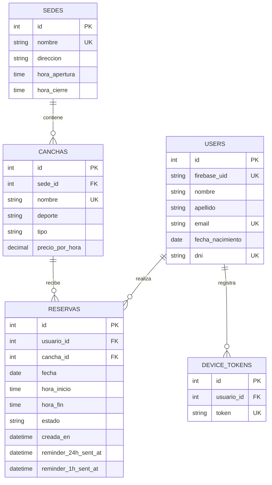

# Modelo de datos - Club Gonzalo Gil



## Relaciones

- Un usuario puede realizar muchas reservas.
- Un usuario puede registrar uno o varios dispositivos para recibir notificaciones.
- Una sede puede contener muchas canchas.
- Una cancha pertenece a una sola sede.
- Una cancha puede tener muchas reservas a lo largo del tiempo.
- Una reserva corresponde a un único usuario y a una única cancha.

## Reglas principales

- El correo, DNI y `firebase_uid` son únicos para cada usuario.
- El nombre de una cancha es único.
- El token de notificación pertenece a un único dispositivo registrado.
- Una reserva confirmada bloquea el horario de su cancha.
- Una reserva cancelada se conserva en el historial, pero libera su horario.
- Las columnas de recordatorio evitan enviar la misma notificación más de una vez.
```